<div align="center">

<picture>
  <source media="(prefers-color-scheme: dark)" srcset="docs/brand/proteus-lockup-dark.svg">
  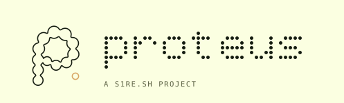
</picture>

<code>~ $ triage for protein design campaigns</code>

[](https://github.com/OtoYuki/proteus/actions/workflows/ci.yml)
[](https://github.com/OtoYuki/proteus/actions/workflows/validate.yml)
[](https://github.com/OtoYuki/proteus/releases/latest)
[](#license)

</div>

A binder campaign ends with a few thousand models, each next to the PAE and score files its
predictor wrote, and room in the lab for a few dozen. Choosing them usually means stitching
together scripts that each read some predictors' files: `ipsae.py` for the interface, Biopython,
mdtraj and FreeSASA for the structure, PyRosetta for the rest. That is an environment to keep
alive, a licence to buy for commercial use, and numbers nobody has compared with anything.

`proteus analyze` reads the folder as it is (AlphaFold 3, Boltz, Chai-1, OpenFold3, Protenix,
ColabFold) and writes one row per model to Parquet, CSV or JSON: the interface scores, MolProbity's
geometry checks, secondary structure, contacts. Every number that has a reference implementation
is checked against it on every push, and the ones that have none are labelled as unchecked. The
interface ranking is measured against lab results on two published datasets.

<p align="center">
  <a href="https://www.youtube.com/watch?v=UUzgT2dDDLg">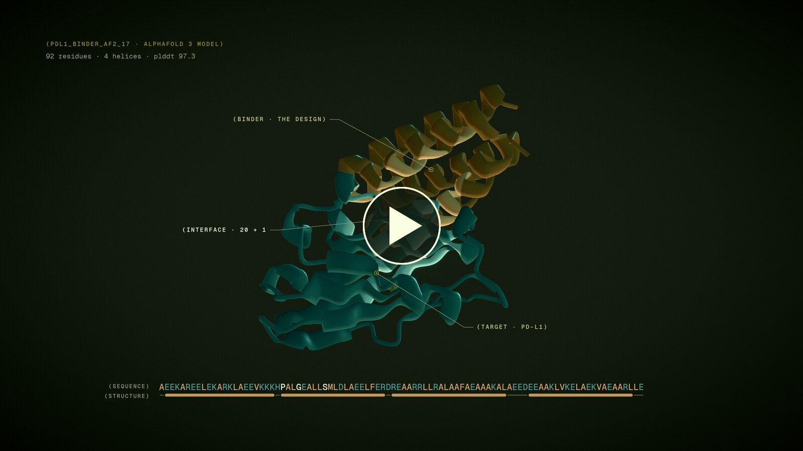</a>
</p>
<p align="center"><sub>The film, 70 s, on YouTube. Every number in it comes from a real run.</sub></p>

## Quick start

```bash
curl -L https://github.com/OtoYuki/proteus/releases/latest/download/proteus-x86_64-unknown-linux-gnu.tar.gz | tar xz
./proteus analyze boltz_results/ --interface A --export triage.parquet  # a binder campaign, one row per model
./proteus analyze boltz_results/ --interface A --html triage.html       # the same rows as one sortable page
./proteus analyze models/ --export qc.parquet                           # any folder of predicted models
./proteus analyze model.pdb                                             # every measurement, one structure
./proteus view model.pdb --web                                          # look at it, in a browser or the terminal
```

macOS, aarch64, `cargo install` and the container image: [Install](#install).

## Contents

[1. Triage a binder campaign](#1-triage-a-binder-campaign) ·
[2. Triage any folder of models](#2-triage-any-folder-of-models) ·
[3. Checked against reference implementations](#3-checked-against-reference-implementations) ·
[4. Look at it, over SSH](#4-look-at-it-over-ssh) ·
[5. Make the models](#5-make-the-models-mutate-fold-rank) ·
[6. Drive it from a workflow engine](#6-drive-it-from-a-workflow-engine) ·
[7. What did the change do?](#7-what-did-the-change-do-diff-and-film)

[Next to other tools](#next-to-other-tools) · [Speed](#speed) · [Install](#install) ·
[Command reference](#command-reference) · [How the numbers are defined](#how-the-numbers-are-defined) ·
[Provenance](#provenance)

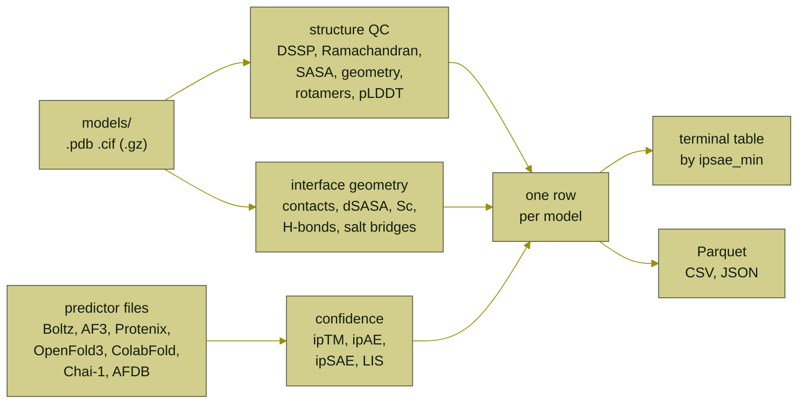

---

## 1. Triage a binder campaign

```bash
proteus analyze boltz_results/ --interface A:B --export triage.parquet
```

`--interface` names the binder and the target: `A:B`, `H,L:A` for a two-chain binder, or `A` for
chain A against every other chain. Each model gets two groups of columns:

- **From the structure:** interface residues on each side (heavy atoms within 4 Å, BindCraft's
  cutoff), buried surface (dSASA), shape complementarity (Sc, Lawrence & Colman 1993), hydrogen
  bonds and salt bridges across the interface.
- **From the predictor's files beside the model:** ipTM, ipAE, ipSAE and LIS. ipSAE (Dunbrack
  2025) is the pTM-style score over only the residue pairs the predictor is confident about,
  reported both ways round; `ipsae_min` is the smaller of the two.

The terminal sorts by `ipsae_min`; the export has every column plus the per-model QC of
[section 2](#2-triage-any-folder-of-models). Twelve IL-7Rα designs drawn at random from the
dataset below, some columns left out. The last column is the lab result, which Proteus never sees:

| model | ipsae_min | iptm | ipae | lis | interface_sc | interface_dsasa | bound in the lab |
|---|---:|---:|---:|---:|---:|---:|:-:|
| `il7ra_binder_af2_48` | 0.698 | 0.87 | 5.1 | 0.613 | 0.57 | 1983 | **yes** |
| `il7ra_binder_af2_34` | 0.646 | 0.89 | 5.0 | 0.633 | 0.70 | 1758 | no |
| `il7ra_binder_af2_93` | 0.622 | 0.86 | 5.6 | 0.605 | 0.60 | 1610 | no |
| `il7ra_binder_af2_94` | 0.587 | 0.88 | 4.8 | 0.650 | 0.70 | 1519 | no |
| `longxing_grafting2_ems_3hc_242_…` | 0.548 | 0.85 | 6.2 | 0.549 | 0.61 | 1653 | no |
| `il7ra_binder_af2_65` | 0.505 | 0.81 | 6.0 | 0.549 | 0.57 | 1887 | no |
| `il7ra_binder_af2_51` | 0.159 | 0.68 | 9.7 | 0.322 | 0.58 | 1194 | no |
| `longxing_hhh_eva_0366_…` | 0.015 | 0.45 | 14.8 | 0.156 | 0.58 | 1659 | no |
| `longxing_grafting2_ems_3hc_306_…` | 0.014 | 0.42 | 15.2 | 0.159 | 0.62 | 1594 | no |
| `il7ra_binder_af2_72` | 0.011 | 0.27 | 19.4 | 0.066 | 0.47 | 1389 | no |
| `bcov_r3_ems_ferrm_5651_…` | 0.000 | 0.28 | 20.9 | 0.004 | 0.50 | 1181 | no |
| `longxing_ems_3hm_2137_…` | 0.000 | 0.26 | 20.5 | 0.018 | 0.57 | 1220 | no |

The binder comes first, but one draw of twelve proves little: five non-binders sit close behind
it, and Sc would have ranked it eighth. What the score is worth over thousands of designs is below.

`proteus view model.cif --web` opens one model coloured by interface (binder in clay, target in
tide, bright where they touch), with a verdict against the 0.61 cutoff and the numbers above. `i`
draws both sides' contact residues as sticks; `b` hands the binder role to another chain; `/`
goes to a residue by name (`B:90`, `90-110`, `GLU90`).

```bash
proteus analyze boltz_results/ --interface A:B --html triage.html
```

writes the whole campaign as one page instead: every model a row, sortable by any column,
filterable by name, with the rows at or above the cutoff for that predictor marked and a click on
a model copying the command that opens it. It is one self-contained file that fetches nothing, so
it travels out of the cluster by `scp` and opens anywhere. `--html` and `--export` can be given
together.

### What these numbers are worth

The 3 669 designs in the Overath et al. 2025 dataset that have a lab result (394 bound, 15
targets), on their AlphaFold 3 models (`make validate-binders`). A campaign ranks its own designs
against one target, so the score is average precision (AP) per target, averaged over the 15. A
random ranking scores the binder rate, 0.131 on average.

<picture>
  <source media="(prefers-color-scheme: dark)" srcset="docs/img/per-target-dark.svg">
  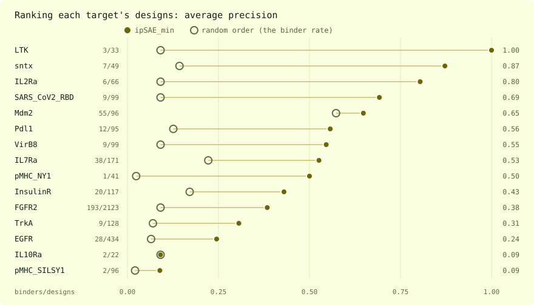
</picture>

<sub><code>ipsae_min</code> on the AlphaFold 3 models of the 3 669 lab-tested designs in Overath et al.
2025, ranked within each target. Dot: the ranking's average precision. Ring: a random order (the
target's binder rate). Drawn from <a href="validate/binders/last_run.md"><code>validate/binders/last_run.md</code></a>;
a test fails if the picture and the report disagree.</sub>

<picture>
  <source media="(prefers-color-scheme: dark)" srcset="docs/img/scores-dark.svg">
  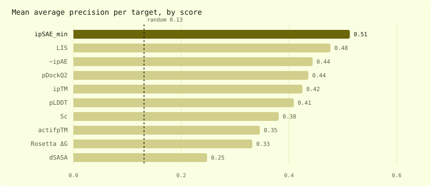
</picture>

| ranked by | AP per target | AUROC | |
|---|---|---|---|
| `ipsae_min` | **0.513** | 0.803 | 3.9× random; the dataset's own ipSAE_min: 0.513 |
| `lis` | 0.477 | 0.808 | |
| `ipae` (lower first) | 0.444 | 0.791 | |
| `iptm` | 0.425 | 0.791 | pDockQ2 (dataset): 0.436 |
| `plddt_mean` | 0.409 | 0.730 | |
| `interface_sc` | 0.381 | 0.714 | the dataset's Rosetta Sc: 0.267, Rosetta ΔG: 0.332 |

`ipsae_min` beats every other score in the dataset, pDockQ2, ColabFold's actifpTM (0.346) and
Rosetta's interface ΔG included. It is an enrichment filter: most top-ranked designs still fail
in the lab, and targets with one to three binders give noisy numbers. Pooling all targets (AP
0.358 against 0.107) mixes binder rates from 2 % to 57 % and mostly measures which targets are
easy.

**At the paper's cutoff,** `ipsae_min > 0.61` keeps 509 designs. 203 of them bound: 40 % of what
you would send to the lab, against 11 % unfiltered, and half of all the binders.

**A second, harder check:** Adaptyv's Nipah competition, 1 196 designs (111 bound), on the
Boltz-2 models and PAE ProteinBase publishes (`make validate-nipah`). `ipsae_min` scores AP 0.191
against a random 0.093 (AUROC 0.658), and the binder rate climbs with the score, from 2.7 % below
0.2 to 38 % above 0.8. Boltz's interface pLDDT ties it here (AUROC 0.707) but not on the Overath
set (Boltz-1: 0.301 per target against `ipsae_min`'s 0.402). The competition chose half its
tested designs by ipSAE; that is not why the margin is smaller, since on the 596 it did not
choose, enrichment is lower still (1.65× against 2.06×). Details:
[`validate/nipah/last_run.md`](validate/nipah/last_run.md).

<picture>
  <source media="(prefers-color-scheme: dark)" srcset="docs/img/nipah-bins-dark.svg">
  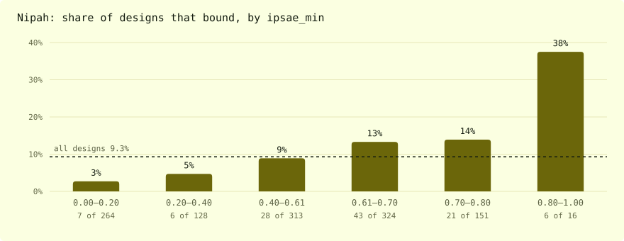
</picture>

### Which cutoff, for which predictor

0.61 was fitted on AlphaFold 3 scores. ipSAE comes from each predictor's own PAE, and PAE is not
calibrated across predictors, so the cutoff does not transfer. Fitted leave-one-target-out on the
Overath designs (the protocol Overath used), and scored on the held-out target:

| predictor | cutoff | held-out precision | enrichment over the binder rate | targets |
|---|---:|---:|---|---:|
| AlphaFold 3 | 0.634 | 0.480 | 4.21× [2.55, 6.12] | 11 |
| ColabFold | 0.585 | 0.282 | 2.11× [1.15, 3.43] | 11 |
| OpenFold3 | 0.683 | 0.324 | 1.84× [1.37, 2.30] | 6 |
| Boltz-1 | 0.711 | 0.315 | 2.62× | 11 |
| Boltz-2 | 0.766 | 0.325 | 1.71× [1.36, 2.16] | 6 |

The predictor that needs the highest cutoff triages worst. AlphaFold 3's fitted 0.634 reproduces
the published 0.61, which is the check on the method. OpenFold3 and Boltz-2 are 673 designs on six
targets, folded for this; 95 % intervals are bootstrapped over targets. `analyze --interface`
prints the line for each predictor it detects, on stderr. Boltz-1 and Boltz-2 write identical file
names, so the Boltz line carries both; Protenix and Chai-1 get none, because neither was folded.
Seed spread was measured for OpenFold3 only: on two targets, a different seed moved 5–15 % of
designs across 0.61.

```sql
-- duckdb: the confident interfaces, chemically sound, best first
SELECT model, ipsae_min, iptm, interface_sc, interface_dsasa, bond_outliers
FROM 'triage.parquet'
WHERE ipsae_min > 0.61 AND interface_sc > 0.6 AND handedness_swaps = 0
ORDER BY ipsae_min DESC;
```

On single-chain targets, ipTM, ipSAE and ipAE agree with the dataset's own values to its
three-decimal rounding (p99 |Δ| 0.0018). Sc is ported from sc-rs and equal to it to 1e-12.
Rosetta's interface ΔG, packstat and unsatisfied hydrogen bonds need an energy function and
explicit hydrogens, and are not computed. Every difference from the dataset, with its reason:
[`validate/binders/`](validate/binders/last_run.md).

## 2. Triage any folder of models

```bash
proteus analyze models/ --export qc.parquet          # every .pdb/.cif(.gz) below models/
proteus analyze designs/*.cif --reference target.pdb --json | jq .rmsd_to_reference
```

One row per structure: sequence, chain and residue counts, pLDDT (only when the file really
carries one), DSSP composition and string, MolProbity-contour Ramachandran, SASA and burial,
heavy-atom overlaps, covalent geometry and rotamers, the interaction network, Rg against the
folded-protein law, optional Kabsch RMSD to a reference, and the triage score.

The covalent-geometry columns are MolProbity's checks as Phenix runs them, and reproduce cctbx
residue by residue ([section 3](#3-checked-against-reference-implementations)): bond and angle
RMSZ and outliers against the Phenix restraint library (geostd, with the Conformation-Dependent
Library for the backbone), chirality and planarity, Cβ deviation, cis and twisted peptides,
Top8000 rotamers. They answer what pLDDT does not: whether the model is chemically sound. All 13
unrelaxed ESMFold models in the corpus have bond-length outliers, mostly short peptide C–N bonds
in residues the model is confident about. After an AlphaFold2-style Amber relaxation that leaves
the fold in place (Cα RMSD ≤ 0.14 Å), none has any ([`validate/predicted/`](validate/predicted/README.md)).

```sql
-- duckdb
SELECT model, plddt_mean, rama_outliers, rg_ratio, bond_outliers, rotamer_outlier_pct
FROM 'qc.parquet'
WHERE plddt_mean > 80 AND rama_outliers = 0 AND rg_ratio < 1.3
  AND handedness_swaps = 0 AND cis_nonpro = 0
ORDER BY fitness DESC;
```

A file that cannot be read is named on stderr and makes the exit status non-zero without stopping
the rest. pLDDT comes from the B-factor column, rescaled when a predictor wrote it on 0–1
(ESMFold); on three AlphaFold DB models the mean matches the database's `globalMetricValue` to
0.01. 1 000 models of 76–142 residues take 39 s on one thread and 6 s on 16; the 3 669
AlphaFold 3 complexes above, with `--interface`, take 83.5 s on 16 (i7-11800H laptop; `-j` sets
the thread count).

## 3. Checked against reference implementations

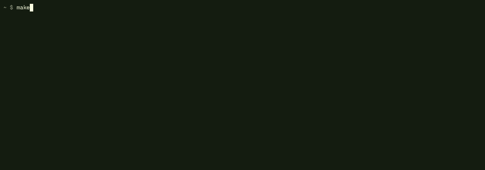

```bash
make validate     # 53 files, 48 entries: X-ray, NMR, cryo-EM, AlphaFold DB; PDB and mmCIF
```

Runs on every push ([`validate.yml`](.github/workflows/validate.yml)). The tolerances are the
contract, in `validate/tolerances.toml`; the last run's full table lands in `validate/last_run.md`.

| what | reference | result |
|---|---|---|
| φ/ψ, Cα radius of gyration | mdtraj | every angle within 0.1°, Rg within 0.01 Å |
| Kabsch–Sander DSSP (`proteus-dssp`) | mdtraj | 99.6 % of 30 335 residues on eight states, 99.96 % on three; worst non-exempt file 97.8 % |
| MolProbity Ramachandran (Top8000 contours) | cctbx `ramalyze` | 100 % label agreement (collagen 1CAG has no reference: cctbx classifies none of its residues) |
| Shrake–Rupley SASA (Bondi radii, 960 pts) | mdtraj, FreeSASA | ≤ 1 % vs mdtraj, ≤ 4 % vs FreeSASA (L&R, ProtOr radii), two documented exceptions |
| hydrogen-bond network | mdtraj `baker_hubbard`, six NMR entries with explicit H | recall 86–100 %, precision 58–79 %: heavy-atom criteria over-detect by 1.3–1.7× |
| salt bridges, π–π stacking, cation–π | PLIP, intra-chain, 15 structures | salt bridges **97.7 %** precision / 72 % recall; π–π **81.8 / 81.8 %**; cation–π **73.9 / 65.4 %** |
| covalent geometry: bonds, angles, chirality, planarity (Phenix restraint library) | cctbx `pdb_interpretation` + `mmtbx.validation.restraints`, 53 corpus files and 13 ESMFold models | every restraint count and every > 4σ outlier identical; RMSZ within 5e-6 |
| Cβ deviation, cis/twisted peptides | cctbx `cbetadev`, `omegalyze` | every residue: Cβ within 0.001 Å, ω within 0.01°, flags identical |
| side-chain rotamers (Top8000) | cctbx `rotalyze` | 26 469 of 26 469 residues identical (χ within 5e-4°, percentile within 5e-5) |
| shape complementarity | sc-rs (the code it is ported from), trypsin–BPTI | equal to 1e-12 |
| ipSAE, LIS on real Boltz-2 output | `ipsae.py` (DunbrackLab, 6174cf9) | ipSAE to 1e-6, LIS to 5e-5, in `cargo test` |
| ipTM, ipSAE, ipAE on AlphaFold 3 models | the Overath et al. dataset's own values, 3 532 single-chain designs (`make validate-binders`, local) | ipTM identical; ipSAE and ipAE p99 \|Δ\| ≤ 0.0018 |
| dSASA, interface H-bonds, interface residues | the dataset's Rosetta values | Pearson r 0.96, 0.77, 0.95 (different definitions; correlation, not parity) |
| heavy-atom steric overlap | none exists with these definitions | labelled as ours, not compared |
| Kabsch RMSD, contact density, burial, triage score | none | unit-tested only; the score is checked against decoys (40/40), not against experiment |

Precision sits next to recall even where precision is the unflattering number. The salt-bridge
cutoff is stricter than PLIP's on purpose (4.0 Å atom to atom against 5.5 Å centre to centre), so
a subset of PLIP's is the intent, and 97.7 % precision says it is the right subset. A real,
understood divergence on one structure is recorded in `validate/tolerances.toml` with its reason
and printed on every run, rather than hidden by widening a tolerance.

Each new reference found something internal testing had missed: PLIP found π–π stacking
over-reported 5× for want of a lateral-offset test, and a larger corpus found the harness itself
collapsing insertion codes, comparing residues 52 and 52A as one.

## 4. Look at it, over SSH

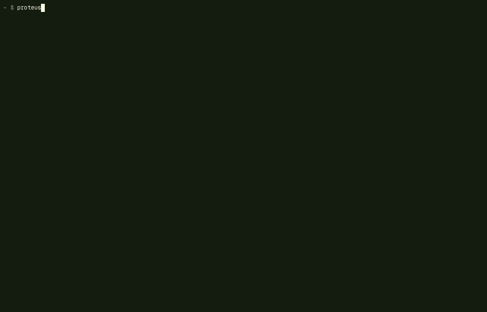

```bash
proteus view <job> --interactive --dashboard        # or a .pdb / .cif / .cif.gz path
proteus view structure.pdb --backend sixel          # a still, for a CI log
proteus view mutant.pdb --compare wildtype.pdb      # superposed; Kabsch RMSD over shared residues
```

A software rasteriser, a cartoon ribbon and a telemetry dashboard, in the terminal: no X11
forwarding, no WebGL, no display server, which is the situation on a cluster login node. The
ribbon follows the Cα trace with its wide face set by the backbone carbonyl (Carson & Bugg 1986),
so β-strands lie flat and show the sheet's real twist; Richardson arrowheads, SSAO, outlines and
disulfide sticks on top.

- **Secondary structure is always computed, never read from the file.** Eight-state DSSP on the
  coordinates, the same `proteus-dssp` validated against mdtraj, so ESMFold's record-less PDBs
  and files whose `HELIX`/`SHEET` records disagree with their coordinates draw correctly.
- **It says when the picture cannot show what you asked for.** At 3.4 Å per pixel, residues 3.8 Å
  apart cannot be separated, so `view` prints the resolution and points at a finer backend.

Backends: ANSI half-block, Braille, **DEC Sixel** (xterm, foot, WezTerm, Windows Terminal, …) and
the kitty graphics protocol, which run locally draws real pixels (`p` toggles). Sixel is 6–21×
lighter on the wire than Proteus's uncompressed kitty output, and its encoder is round-tripped
through libsixel in CI. Keys: arrows or `hjkl` orbit, `+`/`-` zoom, `Space` spin, `Tab` dashboard,
`c` colours, `o` SSAO and outlines, `d` disulfides, `r` reset, `q` quit.

<p align="center">
  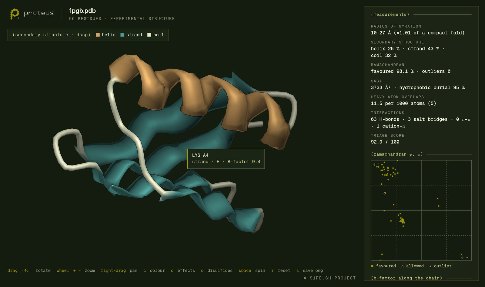
</p>
<p align="center"><sub><code>proteus view 1pgb.pdb --web</code>: the same ribbon, DSSP and measurements,
drawn with WebGL2 in one offline HTML file you can attach to a report.</sub></p>

<table>
  <tr>
    <td width="50%">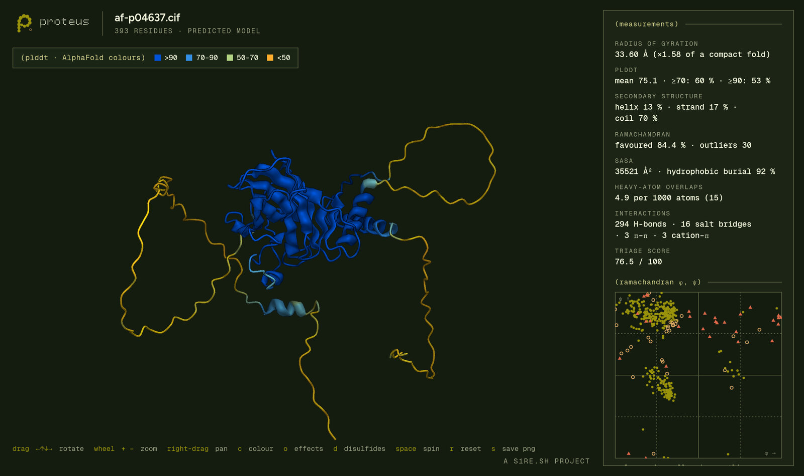</td>
    <td width="50%">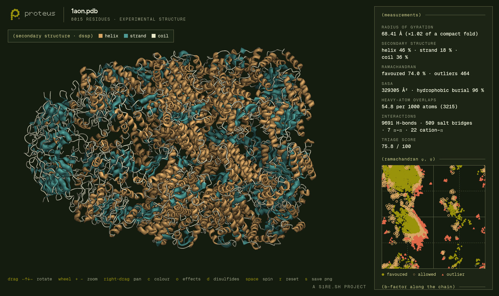</td>
  </tr>
  <tr>
    <td><sub>p53 from AlphaFold DB, in AlphaFold's own pLDDT bands.</sub></td>
    <td><sub>GroEL–GroES (1AON), 8 015 residues.</sub></td>
  </tr>
</table>

## 5. Make the models: mutate, fold, rank

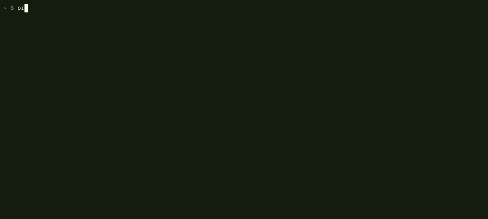

```bash
proteus mutate wt.fasta --mode alanine --start 24 --end 29 \
  | proteus screen - --runner esm-api --top 5 --export library.parquet
```

One pipe, no intermediate files: `mutate` writes a variant library (alanine scan or full
site-saturation), `screen -` folds each variant, measures it and ranks the library.

The ranking is a triage filter, checked on one thing only: a folded structure outranks a broken
one (40/40 native-vs-decoy pairs, in `make validate`). It is not validated against experimental
stability or activity. For a sequence-level signal, `--scorer esm2` ranks by ESM-2 likelihood and
`--scorer hybrid` uses both. Structures from the offline simulator are tagged `engine = simulated`
and kept off the leaderboard unless asked for, and a tier that fell back says which tier you asked
for and why it could not honour it.

## 6. Drive it from a workflow engine

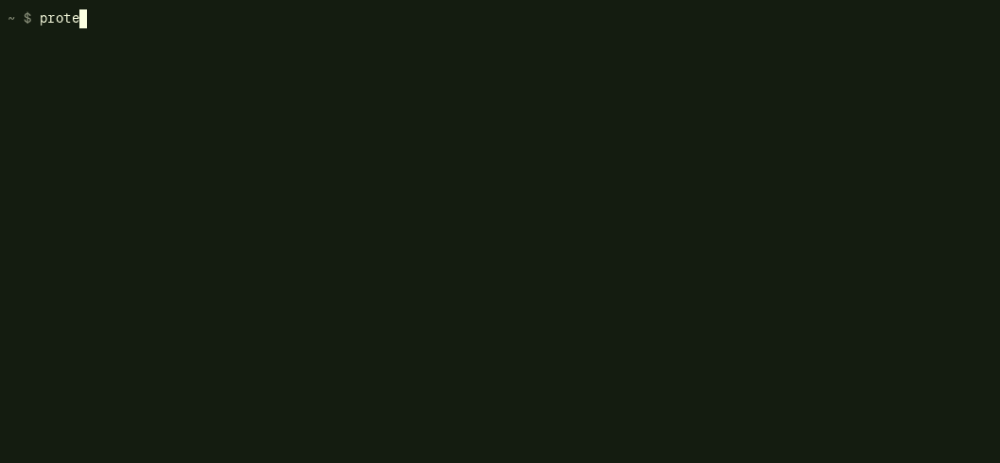

```bash
proteus serve --port 8080 --auth-token "$TOKEN" \
  --allow-image 'ghcr.io/otoyuki/*' --allow-dir "$PWD/work"
nextflow run examples/nextflow/screening.nf      # or: sprocket run … examples/wdl/analyze.wdl
```

`proteus serve` is a **GA4GH TES 1.1** server, one binary on the host's Podman or Docker socket.
It passes the ELIXIR `openapi-test-runner` compliance suite (23/23 cases, 187 assertions) in CI,
against a real container executor. Tasks run in their own image with `resources` enforced;
`--auth-token`, `--allow-image` and `--allow-dir` are the lockdown, and `file://` URLs outside an
allowed directory get a 400 ([SECURITY.md](SECURITY.md)). The Sprocket (WDL) example runs in CI;
the Nextflow one (Nextflow 26 + nf-ga4gh 1.5) is the recording above
([`examples/wdl/README.md`](examples/wdl/README.md)). Swagger UI at `/swagger-ui`, Prometheus
metrics at `/metrics`. An nf-core-style module lives in [`packaging/`](packaging/README.md).

## 7. What did the change do? diff and film

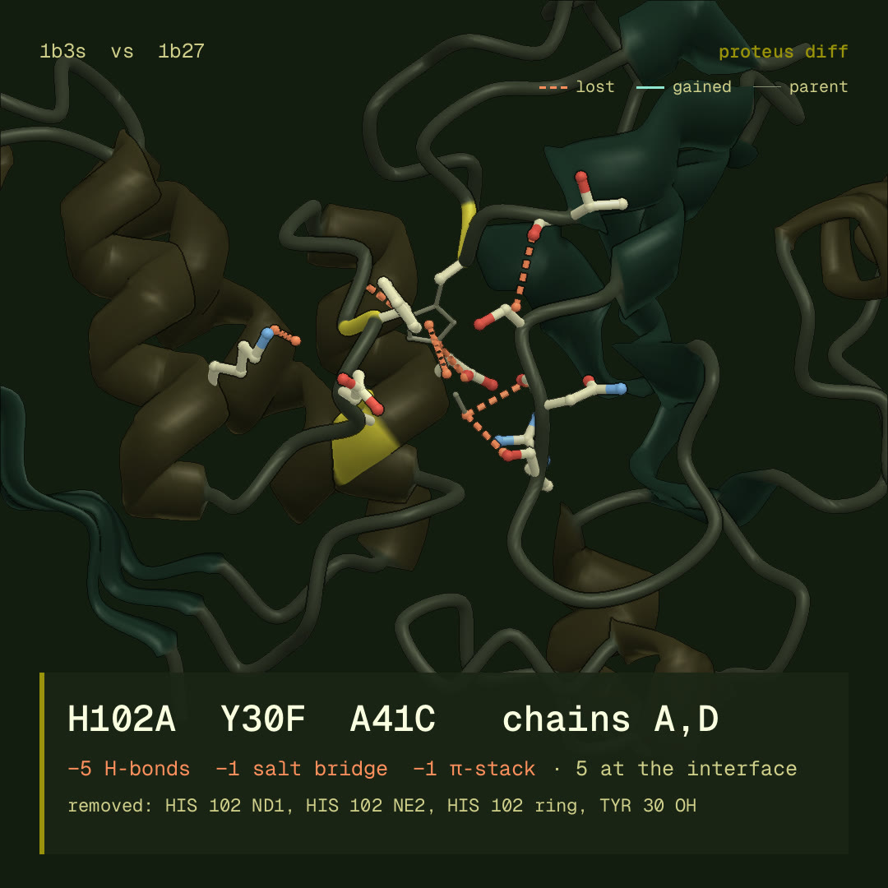

```bash
proteus diff --parent wt.pdb designs/ --csv diff.csv      # one row per candidate
proteus diff --parent 1b27.pdb 1b3s.pdb --chains A,D      # sites and local changes, in full
proteus film --parent 1b27.pdb 1b3s.pdb --chains A,D      # films/1b3s.mp4, .png and .json
```

`diff` pairs each candidate's residues with its parent's, lists the changed sites, superposes,
reads the predictor's confidence at the sites, and diffs the non-covalent interaction networks.
Each lost or gained interaction says whether its atoms were **removed**, moved past the cut-off,
or are only **marginal** (within 0.5 Å of it, an angle flipped, a side chain one file did not
model). Above: barnase H102A with barstar Y30F (1B3S) against 1B27, five interface interactions
lost, each because the side chain that made it is gone.

`film` turns the diff into a 10–20 s MP4 and a still: each site with a clear change, the parent's
removed atoms as ghosts, lost interactions dashed, gained ones solid, then a summary card. Every
caption number is the diff's, written beside the film. Frames render on the GPU (wgpu) or the CPU
rasteriser, whose frames are byte-identical on every run and the GPU's reference. A point mutation
in a *predicted* model often barely moves it (Pak et al., PLoS ONE 2023), so the film shows
confidence and interactions and never reads "nothing moved" as "nothing changed".

---

## Next to other tools

Proteus is not the only Rust implementation of any one of its parts.

| if you want | use |
|---|---|
| a TES server for a **Kubernetes cluster** | [planetary](https://github.com/stjude-rust-labs/planetary) (St. Jude Rust Labs). Proteus is the single binary on a local socket: the other deployment shape, not a better one |
| a single-binary TES on Docker with **S3 staging and a web UI** | [poiesisd](https://github.com/JaeAeich/poiesisd), the same shape as `proteus serve`; development-focused by its author's account |
| structure parsing, BinaryCIF, density maps, **Python/C bindings** | [molex](https://github.com/foldit-org/molex) |
| batch structure features with **interface metrics** and protein–ligand features, into Parquet | [structscope](https://github.com/Danialgharaie/structscope) (work in progress by its own account) |
| ESM **embeddings** across CUDA and MLX | [esm-rs](https://github.com/tcztzy/esm-rs). Proteus's ESM work is variant-effect scoring |
| ESM-2, ESM C and ESM3 on candle as a library | [ferritin](https://github.com/ferritin-bio/ferritin) (`ferritin-plms`) |
| structure prediction and design **inside the binary** | [folding-everywhere](https://github.com/lingxusb/folding-everywhere). Proteus dispatches prediction to containers and APIs |
| a terminal viewer with iTerm2 support and more polish | [ProteinView](https://github.com/001TMF/ProteinView) |
| interactive analysis in a browser | [Mol\*](https://molstar.org), which Proteus does not try to replace |
| to **design** binders | [BindCraft](https://github.com/martinpacesa/BindCraft), or [FreeBindCraft](https://github.com/cytokineking/FreeBindCraft) without PyRosetta. Proteus scores what they, RFdiffusion and BoltzGen produce |
| the reference ipSAE, pDockQ and per-residue output | [`ipsae.py`](https://github.com/DunbrackLab/IPSAE) (Dunbrack lab), which Proteus follows |
| Rosetta interface energies (ΔG, packstat, buried unsatisfied H-bonds) | PyRosetta's InterfaceAnalyzer |
| a full validation report with the all-atom **clashscore** | [MolProbity](https://molprobity.biochem.duke.edu) or `phenix.molprobity`. Proteus reproduces its covalent-geometry, Cβ, ω and rotamer checks, not its all-atom contacts |

Not a folding engine: it orchestrates ESMFold and Boltz, and publishes no prediction image (build
or pull one and point `PROTEUS_IMAGE_FAST` / `PROTEUS_IMAGE_SOTA` at it). Not a replacement for
Mol\*, PyMOL or ChimeraX. Terminal viewers are not rare any more ([StrucTTY](https://github.com/steineggerlab/StrucTTY),
[pixelfold](https://github.com/fuyu-myk/pixelfold), ProteinView). What Proteus adds is narrower:
the measurements a campaign filters on, in one binary, each checked against the implementation
that defines it, with the interface ranking measured against lab results.

## Speed

Same metric, same file, median wall clock; full table in [`bench/README.md`](bench/README.md).

| | vs |
|---|---|
| SASA | 2.3–4.7× mdtraj's C++ kernel (960 points each), ~33× Biopython (96 vs 100 points) |
| DSSP | 1.3–12× mdtraj |
| φ/ψ + Ramachandran | 33–159× mdtraj's φ/ψ API |
| covalent geometry | 1AON (58 674 atoms), end to end, five runs each: 2.15 s against 17.8 s for cctbx's same checks, with identical outliers. The Proteus run also computes SASA, DSSP, Ramachandran, rotamers and H-bonds (not in the bench harness) |

6VXX (22 812 atoms), full profile: 0.69 s. Crambin: ~9 ms.

## Install

```bash
# release binaries: Linux x86_64/aarch64, macOS x86_64/arm64
curl -L https://github.com/OtoYuki/proteus/releases/latest/download/proteus-x86_64-unknown-linux-gnu.tar.gz | tar xz

# from crates.io (Rust 1.94+): the package is proteus-bio, the binary it installs is proteus
cargo install proteus-bio

# container: the CLI works as is; `serve` needs the host's container socket for TES executors
podman run --rm -v "$PWD:/w" ghcr.io/otoyuki/proteus analyze /w/structure.pdb
podman run --rm -p 8080:8080 -v /run/user/$(id -u)/podman/podman.sock:/var/run/docker.sock \
  -v proteus-data:/data ghcr.io/otoyuki/proteus serve --host 0.0.0.0 --allow-dir /data
```

Bioconda (`proteus-bio`) is submitted and waits for review; see [`packaging/`](packaging/README.md).

Python: [`crates/proteus-py`](crates/proteus-py/README.md) builds a `proteus_bio` wheel whose
`analyze()` returns the same rows as a `pyarrow.Table` (`maturin build --release`); not on PyPI yet.

---

## Command reference

Jobs are referred to by UUID or any unique prefix of one, the way git handles commits:
`proteus view 0916a5e6`.

<details>
<summary><b><code>proteus</code></b>: the home screen</summary>

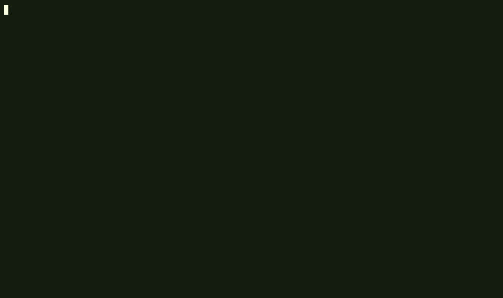

Run with no command in a terminal, `proteus` opens a full-screen home:

- **Jobs:** refreshed every 2 s. Enter opens the 3-D viewer, `w` the browser page, `i` the full
  report, `/` filters, `s` sorts (newest, name, state, pLDDT), `n` renames, `x` deletes after
  asking. On a wide terminal the selected job sits beside the list with a still, its
  measurements and, for a complex, the interface verdict. A failed job shows why.
- **Structures:** a file browser over the current folder; each structure you stop on is measured
  in the background, with the same numbers as `analyze`, and previewed.
- **Run:** forms to fold a sequence (`submit`) or scan a protein (`mutate … | screen -`).

`1` `2` `3` switch tabs (Alt+digit inside a text field). Every action runs a `proteus` command and
the Run forms show it before running, so it can be pasted into a script. In a pipe, bare
`proteus` prints the usage and exits 2.

</details>

<details>
<summary><b><code>proteus analyze</code></b>: one structure in full, or a table over many</summary>

```bash
proteus analyze structure.pdb                          # the full report, below
proteus analyze models/ --export qc.parquet            # one row per file: .parquet, .csv, .json
proteus analyze a.pdb b.cif.gz --json                  # JSON Lines on stdout
proteus analyze models/ --reference wt.pdb -j 8 --top 50
proteus analyze boltz_results/ --interface A:B --export triage.parquet   # binder–target interface
```

Directories are searched recursively for `.pdb`, `.ent`, `.cif` and `.mmcif`, each optionally
gzipped. `--confidence-source predicted|experimental` overrides the pLDDT-vs-B-factor detection.
The Parquet file is tagged `proteus.qc_schema_version = 3` (2 added the eleven covalent-geometry
columns, 3 the thirteen interface columns, empty without `--interface`).

`--interface BINDER[:TARGET]` measures a binder–target interface; without a value it takes the
first chain against the rest. The PAE and scores files are found beside each model:

- Boltz: `pae_<model>.npz` and `confidence_<model>.json`.
- ColabFold: `<name>_scores_rank_….json`.
- AlphaFold 3 run locally: `<name>_confidences.json` and `<name>_summary_confidences.json` beside
  `<name>_model.cif`, or `confidences.json` beside a sample's `model.cif`.
- AlphaFold Server: `<name>_full_data_<k>.json`.
- Protenix: `<job>_full_data_sample_<k>.json` (written with `--need_atom_confidence`) and
  `<job>_summary_confidence_sample_<k>.json` beside `<job>_sample_<k>.cif`.
- OpenFold3: `…_confidences.json` or `.npz` and `…_confidences_aggregated.json` beside `…_model.cif`.
- Chai-1: `scores.model_idx_<k>.npz` (pTM, ipTM) beside `pred.model_idx_<k>.cif`. Its command line
  writes no PAE; a `pae.model_idx_<k>.npy` saved from its Python API is read. Checked against
  Chai-1's source, not its output: it needs more than a 6 GB GPU.

AlphaFold 3-style predictors write one PAE row per token: one per standard residue, one per heavy
atom of a ligand, and for a modified residue one per atom (AlphaFold 3, Boltz-1, Protenix,
OpenFold3) or one (Boltz-2). The protein rows are picked out under whichever convention accounts
for every row, so complexes with ligands and modified residues are scored; real Boltz-2, Protenix
and OpenFold3 output of such a complex is in the tests. When a matrix fits neither convention, the
PAE columns stay empty and `analyze` says why.

1CRN (crambin), an X-ray structure, so no pLDDT: the B-factor column is not a confidence. The ten
worst covalent-geometry outliers follow the table (`--json` carries up to 100):

```
┌──────────────────────────────────────────┬───────────────────────────────────────────────────────────────────┐
│ Biophysical Metric                       ┆ Value                                                             │
╞══════════════════════════════════════════╪═══════════════════════════════════════════════════════════════════╡
│ Radius of Gyration (Rg)                  ┆ 9.676 Å                                                           │
├╌╌╌╌╌╌╌╌╌╌╌╌╌╌╌╌╌╌╌╌╌╌╌╌╌╌╌╌╌╌╌╌╌╌╌╌╌╌╌╌╌╌┼╌╌╌╌╌╌╌╌╌╌╌╌╌╌╌╌╌╌╌╌╌╌╌╌╌╌╌╌╌╌╌╌╌╌╌╌╌╌╌╌╌╌╌╌╌╌╌╌╌╌╌╌╌╌╌╌╌╌╌╌╌╌╌╌╌╌╌┤
│ Contact Density (C-alpha <= 8Å)          ┆ 9.86%                                                             │
├╌╌╌╌╌╌╌╌╌╌╌╌╌╌╌╌╌╌╌╌╌╌╌╌╌╌╌╌╌╌╌╌╌╌╌╌╌╌╌╌╌╌┼╌╌╌╌╌╌╌╌╌╌╌╌╌╌╌╌╌╌╌╌╌╌╌╌╌╌╌╌╌╌╌╌╌╌╌╌╌╌╌╌╌╌╌╌╌╌╌╌╌╌╌╌╌╌╌╌╌╌╌╌╌╌╌╌╌╌╌┤
│ pLDDT                                    ┆ n/a (experimental structure; B-factor column is not a confidence) │
├╌╌╌╌╌╌╌╌╌╌╌╌╌╌╌╌╌╌╌╌╌╌╌╌╌╌╌╌╌╌╌╌╌╌╌╌╌╌╌╌╌╌┼╌╌╌╌╌╌╌╌╌╌╌╌╌╌╌╌╌╌╌╌╌╌╌╌╌╌╌╌╌╌╌╌╌╌╌╌╌╌╌╌╌╌╌╌╌╌╌╌╌╌╌╌╌╌╌╌╌╌╌╌╌╌╌╌╌╌╌┤
│ Secondary Structure Composition          ┆ α-Helix: 47.8% | β-Strand: 8.7% | Coil: 43.5%                     │
├╌╌╌╌╌╌╌╌╌╌╌╌╌╌╌╌╌╌╌╌╌╌╌╌╌╌╌╌╌╌╌╌╌╌╌╌╌╌╌╌╌╌┼╌╌╌╌╌╌╌╌╌╌╌╌╌╌╌╌╌╌╌╌╌╌╌╌╌╌╌╌╌╌╌╌╌╌╌╌╌╌╌╌╌╌╌╌╌╌╌╌╌╌╌╌╌╌╌╌╌╌╌╌╌╌╌╌╌╌╌┤
│ Ramachandran Conformation                ┆ Favored: 97.7% | Allowed: 2.3% | Outliers: 0                      │
├╌╌╌╌╌╌╌╌╌╌╌╌╌╌╌╌╌╌╌╌╌╌╌╌╌╌╌╌╌╌╌╌╌╌╌╌╌╌╌╌╌╌┼╌╌╌╌╌╌╌╌╌╌╌╌╌╌╌╌╌╌╌╌╌╌╌╌╌╌╌╌╌╌╌╌╌╌╌╌╌╌╌╌╌╌╌╌╌╌╌╌╌╌╌╌╌╌╌╌╌╌╌╌╌╌╌╌╌╌╌┤
│ Solvent Accessible Surface Area          ┆ Total: 2973.4 Ų (Hydrophobic Burial: 92.8%)                      │
├╌╌╌╌╌╌╌╌╌╌╌╌╌╌╌╌╌╌╌╌╌╌╌╌╌╌╌╌╌╌╌╌╌╌╌╌╌╌╌╌╌╌┼╌╌╌╌╌╌╌╌╌╌╌╌╌╌╌╌╌╌╌╌╌╌╌╌╌╌╌╌╌╌╌╌╌╌╌╌╌╌╌╌╌╌╌╌╌╌╌╌╌╌╌╌╌╌╌╌╌╌╌╌╌╌╌╌╌╌╌┤
│ Heavy-atom steric overlap (>0.4 Å, no H) ┆ 0.0 per 1k atoms (0 overlaps)                                     │
├╌╌╌╌╌╌╌╌╌╌╌╌╌╌╌╌╌╌╌╌╌╌╌╌╌╌╌╌╌╌╌╌╌╌╌╌╌╌╌╌╌╌┼╌╌╌╌╌╌╌╌╌╌╌╌╌╌╌╌╌╌╌╌╌╌╌╌╌╌╌╌╌╌╌╌╌╌╌╌╌╌╌╌╌╌╌╌╌╌╌╌╌╌╌╌╌╌╌╌╌╌╌╌╌╌╌╌╌╌╌┤
│ Bond lengths (geostd + CDL)              ┆ RMSZ 1.50 | 2 of 337 beyond 4σ                                    │
├╌╌╌╌╌╌╌╌╌╌╌╌╌╌╌╌╌╌╌╌╌╌╌╌╌╌╌╌╌╌╌╌╌╌╌╌╌╌╌╌╌╌┼╌╌╌╌╌╌╌╌╌╌╌╌╌╌╌╌╌╌╌╌╌╌╌╌╌╌╌╌╌╌╌╌╌╌╌╌╌╌╌╌╌╌╌╌╌╌╌╌╌╌╌╌╌╌╌╌╌╌╌╌╌╌╌╌╌╌╌┤
│ Bond angles (geostd + CDL)               ┆ RMSZ 1.55 | 10 of 466 beyond 4σ                                   │
├╌╌╌╌╌╌╌╌╌╌╌╌╌╌╌╌╌╌╌╌╌╌╌╌╌╌╌╌╌╌╌╌╌╌╌╌╌╌╌╌╌╌┼╌╌╌╌╌╌╌╌╌╌╌╌╌╌╌╌╌╌╌╌╌╌╌╌╌╌╌╌╌╌╌╌╌╌╌╌╌╌╌╌╌╌╌╌╌╌╌╌╌╌╌╌╌╌╌╌╌╌╌╌╌╌╌╌╌╌╌┤
│ Chirality | planarity                    ┆ 0 chiral outliers (0 inverted) | 0 planar groups beyond 4σ        │
├╌╌╌╌╌╌╌╌╌╌╌╌╌╌╌╌╌╌╌╌╌╌╌╌╌╌╌╌╌╌╌╌╌╌╌╌╌╌╌╌╌╌┼╌╌╌╌╌╌╌╌╌╌╌╌╌╌╌╌╌╌╌╌╌╌╌╌╌╌╌╌╌╌╌╌╌╌╌╌╌╌╌╌╌╌╌╌╌╌╌╌╌╌╌╌╌╌╌╌╌╌╌╌╌╌╌╌╌╌╌┤
│ Cβ deviation (≥0.25 Å)                   ┆ 0 of 42 residues                                                  │
├╌╌╌╌╌╌╌╌╌╌╌╌╌╌╌╌╌╌╌╌╌╌╌╌╌╌╌╌╌╌╌╌╌╌╌╌╌╌╌╌╌╌┼╌╌╌╌╌╌╌╌╌╌╌╌╌╌╌╌╌╌╌╌╌╌╌╌╌╌╌╌╌╌╌╌╌╌╌╌╌╌╌╌╌╌╌╌╌╌╌╌╌╌╌╌╌╌╌╌╌╌╌╌╌╌╌╌╌╌╌┤
│ Peptide ω                                ┆ 0 cis-Pro | 0 cis non-Pro | 0 twisted (of 45)                     │
├╌╌╌╌╌╌╌╌╌╌╌╌╌╌╌╌╌╌╌╌╌╌╌╌╌╌╌╌╌╌╌╌╌╌╌╌╌╌╌╌╌╌┼╌╌╌╌╌╌╌╌╌╌╌╌╌╌╌╌╌╌╌╌╌╌╌╌╌╌╌╌╌╌╌╌╌╌╌╌╌╌╌╌╌╌╌╌╌╌╌╌╌╌╌╌╌╌╌╌╌╌╌╌╌╌╌╌╌╌╌┤
│ Rotamers (Top8000)                       ┆ outliers 0.0% (0 of 37) | allowed 1                               │
├╌╌╌╌╌╌╌╌╌╌╌╌╌╌╌╌╌╌╌╌╌╌╌╌╌╌╌╌╌╌╌╌╌╌╌╌╌╌╌╌╌╌┼╌╌╌╌╌╌╌╌╌╌╌╌╌╌╌╌╌╌╌╌╌╌╌╌╌╌╌╌╌╌╌╌╌╌╌╌╌╌╌╌╌╌╌╌╌╌╌╌╌╌╌╌╌╌╌╌╌╌╌╌╌╌╌╌╌╌╌┤
│ Hydrogen Bonds (H-Bonds)                 ┆ 53 total (42 BB-BB, 10 BB-SC, 1 SC-SC)                            │
├╌╌╌╌╌╌╌╌╌╌╌╌╌╌╌╌╌╌╌╌╌╌╌╌╌╌╌╌╌╌╌╌╌╌╌╌╌╌╌╌╌╌┼╌╌╌╌╌╌╌╌╌╌╌╌╌╌╌╌╌╌╌╌╌╌╌╌╌╌╌╌╌╌╌╌╌╌╌╌╌╌╌╌╌╌╌╌╌╌╌╌╌╌╌╌╌╌╌╌╌╌╌╌╌╌╌╌╌╌╌┤
│ Ionic Salt Bridges (≤4.0Å)               ┆ 1 detected (closest: ARG17:NH2-GLU23:OE2 3.97Å)                   │
├╌╌╌╌╌╌╌╌╌╌╌╌╌╌╌╌╌╌╌╌╌╌╌╌╌╌╌╌╌╌╌╌╌╌╌╌╌╌╌╌╌╌┼╌╌╌╌╌╌╌╌╌╌╌╌╌╌╌╌╌╌╌╌╌╌╌╌╌╌╌╌╌╌╌╌╌╌╌╌╌╌╌╌╌╌╌╌╌╌╌╌╌╌╌╌╌╌╌╌╌╌╌╌╌╌╌╌╌╌╌┤
│ Aromatic π-π Stacking                    ┆ 0 conjugated pairs (0 parallel, 0 T-shaped)                       │
├╌╌╌╌╌╌╌╌╌╌╌╌╌╌╌╌╌╌╌╌╌╌╌╌╌╌╌╌╌╌╌╌╌╌╌╌╌╌╌╌╌╌┼╌╌╌╌╌╌╌╌╌╌╌╌╌╌╌╌╌╌╌╌╌╌╌╌╌╌╌╌╌╌╌╌╌╌╌╌╌╌╌╌╌╌╌╌╌╌╌╌╌╌╌╌╌╌╌╌╌╌╌╌╌╌╌╌╌╌╌┤
│ Cation-π Interactions                    ┆ 0 active interactions                                             │
├╌╌╌╌╌╌╌╌╌╌╌╌╌╌╌╌╌╌╌╌╌╌╌╌╌╌╌╌╌╌╌╌╌╌╌╌╌╌╌╌╌╌┼╌╌╌╌╌╌╌╌╌╌╌╌╌╌╌╌╌╌╌╌╌╌╌╌╌╌╌╌╌╌╌╌╌╌╌╌╌╌╌╌╌╌╌╌╌╌╌╌╌╌╌╌╌╌╌╌╌╌╌╌╌╌╌╌╌╌╌┤
│ Non-Covalent Network Density             ┆ 117.4 contacts / 100 res                                          │
├╌╌╌╌╌╌╌╌╌╌╌╌╌╌╌╌╌╌╌╌╌╌╌╌╌╌╌╌╌╌╌╌╌╌╌╌╌╌╌╌╌╌┼╌╌╌╌╌╌╌╌╌╌╌╌╌╌╌╌╌╌╌╌╌╌╌╌╌╌╌╌╌╌╌╌╌╌╌╌╌╌╌╌╌╌╌╌╌╌╌╌╌╌╌╌╌╌╌╌╌╌╌╌╌╌╌╌╌╌╌┤
│ Candidate Fitness Score                  ┆ 98.2 / 100                                                        │
└──────────────────────────────────────────┴───────────────────────────────────────────────────────────────────┘
┌─────────────────────────┬───────────────────────────────────────────┬─────────┬─────────┬──────┐
│ Worst geometry outliers ┆ Atoms                                     ┆ Ideal   ┆ Model   ┆ Z    │
╞═════════════════════════╪═══════════════════════════════════════════╪═════════╪═════════╪══════╡
│ angle                   ┆ A 14 ASN OD1 – A 14 ASN CG – A 14 ASN ND2 ┆ 122.600 ┆ 128.625 ┆ -6.0 │
├╌╌╌╌╌╌╌╌╌╌╌╌╌╌╌╌╌╌╌╌╌╌╌╌╌┼╌╌╌╌╌╌╌╌╌╌╌╌╌╌╌╌╌╌╌╌╌╌╌╌╌╌╌╌╌╌╌╌╌╌╌╌╌╌╌╌╌╌╌┼╌╌╌╌╌╌╌╌╌┼╌╌╌╌╌╌╌╌╌┼╌╌╌╌╌╌┤
│ bond                    ┆ A 37 GLY N – A 37 GLY CA                  ┆ 1.447   ┆ 1.518   ┆ -5.8 │
├╌╌╌╌╌╌╌╌╌╌╌╌╌╌╌╌╌╌╌╌╌╌╌╌╌┼╌╌╌╌╌╌╌╌╌╌╌╌╌╌╌╌╌╌╌╌╌╌╌╌╌╌╌╌╌╌╌╌╌╌╌╌╌╌╌╌╌╌╌┼╌╌╌╌╌╌╌╌╌┼╌╌╌╌╌╌╌╌╌┼╌╌╌╌╌╌┤
│ angle                   ┆ A 7 ILE CA – A 7 ILE C – A 7 ILE O        ┆ 120.950 ┆ 115.385 ┆ +5.4 │
├╌╌╌╌╌╌╌╌╌╌╌╌╌╌╌╌╌╌╌╌╌╌╌╌╌┼╌╌╌╌╌╌╌╌╌╌╌╌╌╌╌╌╌╌╌╌╌╌╌╌╌╌╌╌╌╌╌╌╌╌╌╌╌╌╌╌╌╌╌┼╌╌╌╌╌╌╌╌╌┼╌╌╌╌╌╌╌╌╌┼╌╌╌╌╌╌┤
│ angle                   ┆ A 12 ASN OD1 – A 12 ASN CG – A 12 ASN ND2 ┆ 122.600 ┆ 127.608 ┆ -5.0 │
├╌╌╌╌╌╌╌╌╌╌╌╌╌╌╌╌╌╌╌╌╌╌╌╌╌┼╌╌╌╌╌╌╌╌╌╌╌╌╌╌╌╌╌╌╌╌╌╌╌╌╌╌╌╌╌╌╌╌╌╌╌╌╌╌╌╌╌╌╌┼╌╌╌╌╌╌╌╌╌┼╌╌╌╌╌╌╌╌╌┼╌╌╌╌╌╌┤
│ angle                   ┆ A 36 PRO C – A 37 GLY N – A 37 GLY CA     ┆ 122.550 ┆ 117.411 ┆ +4.7 │
├╌╌╌╌╌╌╌╌╌╌╌╌╌╌╌╌╌╌╌╌╌╌╌╌╌┼╌╌╌╌╌╌╌╌╌╌╌╌╌╌╌╌╌╌╌╌╌╌╌╌╌╌╌╌╌╌╌╌╌╌╌╌╌╌╌╌╌╌╌┼╌╌╌╌╌╌╌╌╌┼╌╌╌╌╌╌╌╌╌┼╌╌╌╌╌╌┤
│ angle                   ┆ A 21 THR O – A 21 THR C – A 22 PRO N      ┆ 121.270 ┆ 125.513 ┆ -4.4 │
├╌╌╌╌╌╌╌╌╌╌╌╌╌╌╌╌╌╌╌╌╌╌╌╌╌┼╌╌╌╌╌╌╌╌╌╌╌╌╌╌╌╌╌╌╌╌╌╌╌╌╌╌╌╌╌╌╌╌╌╌╌╌╌╌╌╌╌╌╌┼╌╌╌╌╌╌╌╌╌┼╌╌╌╌╌╌╌╌╌┼╌╌╌╌╌╌┤
│ angle                   ┆ A 1 THR CA – A 1 THR CB – A 1 THR OG1     ┆ 109.600 ┆ 103.060 ┆ +4.4 │
├╌╌╌╌╌╌╌╌╌╌╌╌╌╌╌╌╌╌╌╌╌╌╌╌╌┼╌╌╌╌╌╌╌╌╌╌╌╌╌╌╌╌╌╌╌╌╌╌╌╌╌╌╌╌╌╌╌╌╌╌╌╌╌╌╌╌╌╌╌┼╌╌╌╌╌╌╌╌╌┼╌╌╌╌╌╌╌╌╌┼╌╌╌╌╌╌┤
│ angle                   ┆ A 34 ILE O – A 34 ILE C – A 35 ILE N      ┆ 123.180 ┆ 127.746 ┆ -4.3 │
├╌╌╌╌╌╌╌╌╌╌╌╌╌╌╌╌╌╌╌╌╌╌╌╌╌┼╌╌╌╌╌╌╌╌╌╌╌╌╌╌╌╌╌╌╌╌╌╌╌╌╌╌╌╌╌╌╌╌╌╌╌╌╌╌╌╌╌╌╌┼╌╌╌╌╌╌╌╌╌┼╌╌╌╌╌╌╌╌╌┼╌╌╌╌╌╌┤
│ angle                   ┆ A 45 ALA N – A 45 ALA CA – A 45 ALA CB    ┆ 110.440 ┆ 103.984 ┆ +4.2 │
├╌╌╌╌╌╌╌╌╌╌╌╌╌╌╌╌╌╌╌╌╌╌╌╌╌┼╌╌╌╌╌╌╌╌╌╌╌╌╌╌╌╌╌╌╌╌╌╌╌╌╌╌╌╌╌╌╌╌╌╌╌╌╌╌╌╌╌╌╌┼╌╌╌╌╌╌╌╌╌┼╌╌╌╌╌╌╌╌╌┼╌╌╌╌╌╌┤
│ bond                    ┆ A 35 ILE N – A 35 ILE CA                  ┆ 1.461   ┆ 1.497   ┆ -4.2 │
└─────────────────────────┴───────────────────────────────────────────┴─────────┴─────────┴──────┘
2 more outliers not shown.
```

</details>

<details>
<summary><b><code>proteus view</code></b>: the terminal and browser viewers</summary>

```bash
proteus view structure.pdb --interactive --dashboard
proteus view structure.pdb --backend halfblock --color ss --width 80 --height 36
proteus view structure.pdb --backend sixel        # or braille, or kitty
proteus view mutant.pdb --compare wildtype.pdb --interactive
proteus view structure.pdb --html out.html        # the self-contained WebGL2 page, works offline
proteus view structure.pdb --gltf ribbon.glb      # the ribbon as glTF, for Blender, Keynote, three.js
scripts/gallery.sh                                # a gallery of such pages (target/gallery/)
```

`--compare` pairs residues by chain ID and number, by number alone for two single-chain files, or
by sequence alignment, whichever matches most, and superposes only the paired residues. The RMSD
is marked `✓` when the two are the same sequence residue for residue, and `!` with a warning
otherwise. `--web` and `--html` draw one structure and refuse `--compare`. `--gltf` writes the
ribbon as binary glTF 2.0, tessellated finer than the screen (12 samples per residue, a 16-sided
profile), coloured by `--color` or `--color-by` as vertex colours, in the file's own ångström
coordinates; Khronos's validator reports no errors or warnings on 1CRN, 1B3S and 1AON.

In a kitty-protocol terminal (kitty, WezTerm, Ghostty), run locally rather than over SSH or in
tmux, the interactive viewer draws real pixels; `p` switches to half-block cells, which are drawn
3 × 3 supersampled. A complex opens coloured by interface; a model confident everywhere opens on
its secondary structure, since in pLDDT colours it would be one flat blue. In the terminal, `[`
and `]` step through the findings below; `0` clears.

```bash
proteus view <job> --web                                       # PAE and pTM found beside the model
proteus view AF-P69905-F1-model_v6.pdb --pae pae.json --web    # or named explicitly
proteus view model.pdb --color-by scan.csv --web               # an `esm scan --export` matrix
proteus view model.pdb --color-by AF-P69905-F1-aa-substitutions.csv:am_pathogenicity --web
proteus view model.pdb --compare reference.pdb --web           # coloured by how far each residue moved
```

The browser page:

- **Confidence.** pTM (ipTM for a complex) and the PAE map in AlphaFold DB's colours, from
  Boltz, AlphaFold DB, ColabFold or AlphaFold 3 files beside the model or given with `--pae`.
  Hover reads a cell; drag a box for the mean error between two ranges.
- **Selection.** Click the structure, the sequence track, a Ramachandran point, the pLDDT strip
  or the PAE map: the rest dims, the selection and everything within 5 Å become sticks, and a box
  gives distances, PAE both ways, neighbours and a PyMOL selection. `n` neighbourhood, `f` focus,
  `Esc` clears.
- **Findings.** Ramachandran outliers, heavy-atom overlaps, hydrogen bonds, salt bridges and π
  interactions, each selecting its residues with a dashed line between the atoms.
- **Ligands.** Non-water HETATM groups as sticks; selecting one shows its binding site.
- **Scores.** `--color-by FILE[:COLUMN]` colours residues by a mutational scan, a variant-effect
  table (AlphaMissense, `proteus screen` exports) or per-residue values, with a residue ×
  amino-acid map. Red is the damaging end; `--higher-is-worse`/`--lower-is-worse` override. A
  table for another sequence is refused.
- **Comparison.** `--compare` draws the reference (`x` hides it) and colours by Cα deviation.
- **Complexes.** Per-chain pTM and an ipTM grid; ligand PAE tokens averaged into one row; several
  samples listed with their scores and RMSD to the one shown.
- **Measuring.** `m`: two atoms a distance, three an angle, four a dihedral. `l` pins labels.
- **Surfaces.** `u` cycles a Gaussian molecular surface (Grant & Pickup 1995) coloured like the
  ribbon, by Kyte–Doolittle hydrophobicity, or by Coulombic potential (ε = 4r, ChimeraX's
  default): an estimate, not Poisson–Boltzmann.
- **Files and sessions.** The page carries the model and hands it back with its PAE; the view
  lives in the URL, so a copied link opens it the same way.

</details>

<details>
<summary><b><code>proteus diff</code></b> and <b><code>proteus film</code></b>: what candidates changed against their parent</summary>

```bash
proteus diff --parent PARENT CANDIDATE... [--chains A,D] [--local-radius 10] [--all]
             [--json | --csv FILE]
proteus film --parent PARENT CANDIDATE... [--chains A,D] [--out films]
             [--aspect 1:1|4:5|16:9] [--fps 30] [--pace 1] [--max-sites 3]
             [--renderer auto|gpu|cpu] [--encoder auto|nvenc|x264]
             [--still-only] [--still-at SECONDS] [--supersample 2]
```

One candidate prints its sites (local Cα RMSD, pLDDT in parent and candidate) and its clear local
interaction changes; several print a table. `--all` adds marginal changes. The CSV holds what a
ranking sorts on: lost and gained H-bonds, salt bridges, π-stacks and cation–π within the local
radius, interface changes, marginal and distal counts, identity, coverage, the lowest site pLDDT
and the mean pLDDT change at the sites. Low identity with low coverage means the wrong parent.

`film` writes `<candidate>.mp4` (H.264, BT.709, faststart), `.png` and `.json`. `--renderer auto`
uses a hardware GPU and refuses software adapters; `cpu` is the reference. Without ffmpeg the
still and the JSON are still written.

</details>

<details>
<summary><b><code>proteus mutate</code></b>, <b><code>screen</code></b>, <b><code>submit</code></b>: libraries, folding, jobs</summary>

```bash
proteus mutate scaffold.fasta --mode alanine --output library.fasta
proteus mutate scaffold.fasta --mode saturation --start 10 --end 18 --max-variants 50
proteus screen library.fasta --tier fast --workers 8 --min-plddt 75 --top 10 --export results.parquet
```

`--runner` picks where folding happens: `oci` (a local container image), `esm-api` (the Meta
ESMFold API), `simulated` (an offline placeholder helix), or `auto`, which tries them in that
order. `--export` takes `.parquet`, `.csv` or `.json` and refuses anything else. Exports carry an
`engine` column and the tag `proteus.schema_version = 5`.

The `sota` tier runs Boltz-2 from an image you build once (16 GB, weights included):

```bash
podman build -t ghcr.io/jwohlwend/boltz:latest containers/boltz
systemctl --user enable --now podman.socket
proteus submit -f ubiquitin.fasta --tier sota --runner oci
# chains and ligands in Boltz's header syntax (plain `>name` records are protein chains)
printf '>A|protein|empty\nPQITLWQRPL…\n>B|protein|empty\nPQITLWQRPL…\n>L|ccd\nMK1\n' > hivpr_mk1.fasta
proteus submit -f hivpr_mk1.fasta --tier sota --runner oci --samples 3
proteus submit -f target.fasta --tier sota --runner oci --msa server   # sends the sequence to ColabFold's server
proteus submit -f target.fasta --tier sota --runner oci --msa my.a3m   # your own alignment
proteus view <job> --model 2                                            # any of the samples
```

`--msa` is off by default: nothing leaves the machine and Boltz folds from the single sequence,
fine for well-studied folds, weaker for orphan proteins. Samples run one at a time and alignments
are capped at 1 024 sequences (`PROTEUS_BOLTZ_PARALLEL_SAMPLES`, `PROTEUS_BOLTZ_MAX_MSA_SEQS`),
which fits a 6 GB GPU. On an RTX 3060 Laptop the HIV-1 protease dimer with indinavir (243 tokens,
server MSA, 3 samples) takes 86 s: pTM 0.984, ipTM 0.982, 0.24 Å Cα RMSD from 1HSG and
0.39–0.82 Å for the ligand pose. 1HSG is from 1995 and in Boltz's training data, so this shows the
pipeline works, not how Boltz does on a new complex. Human ubiquitin folds in 50 s at 3.7 GB of
GPU memory, 0.80 Å from 1UBQ.

Containers get the GPU through CDI (`nvidia.com/gpu=all`) when `/etc/cdi/nvidia.yaml` exists
(`nvidia-ctk cdi generate`); `PROTEUS_GPU=off` keeps them on the CPU, any other value names the
CDI device.

```bash
proteus submit --file wt.fasta --runner esm-api    # prints the job id
proteus status 0916a5e6                            # state, tier, timings
proteus inspect 0916a5e6                           # the full biophysical report
proteus rename 0916a5e6 'PD-L1 binder 7'           # the name the lists show
proteus delete 0916a5e6                            # records and files (alias: rm); --keep-files keeps the folder
proteus serve --port 8080 --host 0.0.0.0 --auth-token "$TOKEN" \
  --allow-image 'ghcr.io/otoyuki/*' --allow-dir /srv/tes-store
```

</details>

<details>
<summary><b><code>proteus esm</code></b>: ESM-2 in pure Rust</summary>

```bash
proteus esm score wildtype.fasta --mutations P19A,C4S --esm-masked
proteus esm scan wildtype.fasta --export scan.csv     # 20×L matrix + a terminal heat map
proteus mutate wt.fasta --mode saturation | proteus screen - --scorer hybrid --export lib.parquet
```

`proteus-esm` re-implements `EsmForMaskedLM` on [candle](https://github.com/huggingface/candle):
no Python, no PyTorch. It loads `facebook/esm2_t6_8M` through `esm2_t33_650M` from the Hub (3B and
15B publish only sharded PyTorch files; convert to safetensors and load from disk) and gives
zero-shot mutation scores, wild-type or masked marginals (Meier et al. 2021), and full deep
mutational scans.

- **Parity:** logits within 2e-4 and log-probabilities within 1e-4 of
  `transformers.EsmForMaskedLM` (fp32; largest observed 4.6e-5 / 3.3e-5), on three short proteins
  and one of 1 022 residues, two checkpoints. CI runs the 8M checkpoint on every push.
- **Input:** at most 1 022 residues; substitutions between the 20 standard amino acids;
  `[mutation=A10G:C4S]` (ProteinGym's separator) works in library headers.
- **Accuracy:** ProteinGym v1.1, the five smallest single-mutant assays, mean |ρ| 0.42 with
  `esm2_t12_35M` and 0.24 with `esm2_t6_8M` ([`bench/README.md`](bench/README.md)).
- **Weaker on viral proteins:** ProteinGym's own table gives ESM-2 650M ρ 0.457 on human assays
  and 0.261 on viral ones (0.414 over all 217). Past 400 residues, score known domains separately.
- ESM C and the open ESM3 weights are MIT since mid-2026; they are different architectures and not
  implemented here.

</details>

<details>
<summary><b>The crates</b></summary>

A Cargo workspace of eight. Two depend on nothing else here and are meant to be used on their own;
the other six are the application and ship as the `proteus` binary.

```
crates/
├── proteus-dssp/       Kabsch–Sander DSSP, 8-state. No dependencies by default.
├── proteus-esm/        ESM-2 masked-LM inference on candle. Standalone.
├── proteus-core/       Domain models, FASTA, DMS mutagenesis, all-atom biophysics
├── proteus-storage/    SQLite (SQLx WAL), BLAKE3 CAS, Parquet/CSV/JSON export
├── proteus-engine/     Async scheduler, prediction runners, TES task execution (bollard)
├── proteus-render/     Software 3D rasteriser, ribbon extruder, TUI dashboard
├── proteus-server/     Axum daemon: GA4GH TES 1.1, native API, SSE, OpenAPI
└── proteus-cli/        The binary: analyze, view, diff, film, mutate, screen, esm, submit, serve
```

On crates.io every crate is published as `proteus-bio-*` (the binary as `proteus-bio`), because
`proteus-cli`, `proteus-engine` and `proteus-render` are taken there by unrelated projects. The
library names are unchanged: `proteus-bio-dssp` is still `use proteus_dssp::…`.

</details>

<details>
<summary><b>Building and checking it yourself</b></summary>

```bash
cargo build --release                                  # target/release/proteus
cargo test --workspace                                 # unit, integration and doc tests
cargo clippy --workspace --all-targets -- -D warnings
cargo fmt --check
scripts/smoke.sh                                       # every command end to end, with assertions
scripts/smoke.sh --tes IMAGE                           # …and a real TES task in a container
make validate                                          # the 53-file corpus (needs uv; ~50 MB of structures, ~650 MB of Python tools, once)
bench/run.sh                                           # criterion + mdtraj/FreeSASA/Biopython
```

Rust 1.94 or newer. A container runtime is optional: a rootless Podman socket
(`systemctl --user enable --now podman.socket`) or a Docker daemon, for the OCI runner and TES
executors.

</details>

---

## How the numbers are defined

All-atom, pure Rust, O(N) through spatial cell lists. SASA is Shrake–Rupley with a 960-point
Fibonacci sphere and Bondi radii; Ramachandran uses the six Top8000 contour grids converted from
cctbx (Favored ≥ 2 %, Allowed ≥ 0.05–0.2 %); rotamers the seventeen Top8000 χ distributions
(outlier below 0.3 %, allowed below 2 %); secondary structure is eight-state DSSP from backbone
H-bond energies with a three-state reduction.

### Radius of gyration

$$\mathbf{r}_{\text{cm}} = \frac{1}{N}\sum_{i=1}^N \mathbf{r}_i \quad\text{over all } C_\alpha\text{ atoms}$$

$$R_g = \sqrt{\frac{1}{N}\sum_{i=1}^N \|\mathbf{r}_i - \mathbf{r}_{\text{cm}}\|^2}$$

### Kabsch superposition (Cα RMSD)

For centred coordinate matrices $P, Q \in \mathbb{R}^{N \times 3}$:

1. Cross-covariance: $H = P^T Q$.
2. SVD: $H = U \Sigma V^T$.
3. Correct for reflection:
   $$R = V \begin{pmatrix} 1 & 0 & 0 \\ 0 & 1 & 0 \\ 0 & 0 & \det(V U^T) \end{pmatrix} U^T$$
4. $\text{RMSD} = \sqrt{\frac{1}{N}\sum_{i=1}^N \|R \mathbf{p}_i - \mathbf{q}_i\|^2}$

### Heavy-atom steric overlap

$$\text{Clash}_{1k} = \frac{\sum_{i < j} \mathbb{I}\left(r_i^{\text{vdW}} + r_j^{\text{vdW}} - d_{ij} > 0.40\text{ \AA}\right)}{N_{\text{atoms}}} \times 1000$$

Excluding atoms in the same residue, backbone peptide linkages and proline ring geometry
($|res_i - res_j| = 1$ in the same chain), disulfide-bonded sulfur pairs
($d(S_\gamma, S_\gamma) \in [1.70, 2.60]$ Å), and hydrogen-bond donor–acceptor pairs at 2.4 Å or
more. The last one matters: with heavy-atom radii (N 1.55, O 1.52 Å) every ordinary N–H···O
hydrogen bond and salt bridge (2.5–3.1 Å) overlaps by more than 0.4 Å, and MolProbity only avoids
calling them clashes because it adds the hydrogens first. This is **not** the MolProbity
clashscore: it under-counts on deposited structures and is meant as a relative screen for grossly
overlapping predicted models.

### Covalent geometry

Every bond length, bond angle, chiral volume and planar group of the 20 amino acids and
selenomethionine against Phenix's default restraints: geostd monomers (Engh & Huber 1991), the
Conformation-Dependent Library v1.2 for every residue linked on both sides, Engh & Huber 1999 for
cis-proline, peptide links, C-terminal carboxylates and disulfides. Symmetric side-chain atoms
named against the IUPAC convention are swapped first, as Phenix does. Heavy atoms only, so it works
on predicted models.

For each restraint with target $x_0$ and esd $\sigma$, $Z = (x_0 - x)/\sigma$; a restraint is an
outlier when $|Z| > 4$, and $\text{RMSZ} = \sqrt{\tfrac{1}{n}\sum Z^2}$ over all $n$ restraints of a
type (≈ 1 for a well-refined structure). Chiral volume for a centre $c$ with neighbours $a, b, d$:
$V = (a - c)\cdot\big((b - c)\times(d - c)\big)$, $\sigma = 0.2$ ų; a centre is **inverted** only
when $V$ lies on the other side of zero by at least half the ideal magnitude. A planar group is
scored by the largest distance of an atom from the weighted least-squares plane, divided by that
atom's esd. Cβ deviation is the distance from the modelled CB to the mean of two ideal CB positions
built from N, CA, C (outlier ≥ 0.25 Å); ω is cis within 30° of 0° and twisted between 30° and 150°.

### Non-covalent interactions

- **Hydrogen bonds** (heavy-atom criteria, backbone and side chain):
  $$2.4\,\text{Å} \le d(D, A) \le 3.5\,\text{Å}, \quad \theta(D_{\text{ante}}-D\cdots A) \ge 90^\circ, \quad \theta(A_{\text{ante}}-A\cdots D) \ge 90^\circ$$
- **Salt bridges:**
  $$d(\text{cation}, \text{anion}) \le 4.0\,\text{Å} \quad\text{with}\quad (chain, res)_{\text{cat}} \neq (chain, res)_{\text{ani}}$$
- **π–π stacking**, centroids $\mathbf{c}_i$ with ring normals $\mathbf{n}_i$, lateral offset ≤ 2.0 Å (PLIP's criterion):
  $$d(\mathbf{c}_1, \mathbf{c}_2) \le 6.5\,\text{Å}, \quad \theta = \arccos(|\mathbf{n}_1 \cdot \mathbf{n}_2|) \implies \begin{cases} \text{parallel} & \theta \le 30^\circ \\ \text{T-shaped} & 60^\circ \le \theta \le 120^\circ \end{cases}$$
- **Cation–π:**
  $$d(\text{cation}, \mathbf{c}) \le 6.0\,\text{Å}, \quad \cos\alpha = \frac{|\mathbf{n} \cdot (\mathbf{r}_{\text{cat}} - \mathbf{c})|}{\|\mathbf{r}_{\text{cat}} - \mathbf{c}\|} \ge \frac{1}{\sqrt{2}}$$

### Interfaces

Contacts are heavy atoms within 4 Å across the interface. dSASA is the two sides' SASA minus the
complex's, same Shrake–Rupley settings. Shape complementarity is Lawrence & Colman's Sc over
Connolly surfaces (1.7 Å probe, 15 dots/Ų, 1.5 Å peripheral band, w = 0.5 Å⁻²), ported from sc-rs.
ipAE is the mean inter-chain PAE over both directions.

### ipSAE

For an ordered chain pair (aligned chain $A$, scored chain $B$) and a residue $i \in A$, let
$V_i = \{\, j \in B : \text{PAE}_{ij} < 10\,\text{Å} \,\}$ and $n_i = |V_i|$:

$$d_0(n) = \max\!\left(1,\; 1.24\,\sqrt[3]{\max(n, 26) - 15} - 1.8\right)$$

$$\text{ipSAE}_{A \to B} = \max_{i \in A} \; \frac{1}{n_i} \sum_{j \in V_i} \frac{1}{1 + \left(\text{PAE}_{ij} / d_0(n_i)\right)^2}$$

`ipsae_min` and `ipsae_max` are the smaller and larger of $A \to B$ and $B \to A$ over every
binder–target chain pair. A direction with no pair under 10 Å scores 0. LIS is the mean of
$(12 - \text{PAE}_{ij})/12$ over the inter-chain pairs under 12 Å, averaged over the two
directions.

### Composite fitness score

$$S_{\text{fitness}} = 0.30 \cdot \text{pLDDT} + 0.20 \cdot S_{\text{compactness}} + 0.15 \cdot f_{\text{favored}} + 0.15 \cdot f_{\text{burial}} + 0.20 \cdot B_{\text{network}} - P_{\text{clash}}$$

$S_{\text{compactness}}$ compares $R_g$ against the empirical folded-protein law
$2.2\,N^{0.38}$ Å. The network term rewards secondary and tertiary contacts:

$$B_{\text{network}} = \min\left(100,\; 100 \cdot \frac{0.5 N_{\text{bb}} + 1.0 N_{\text{sc-hbond}} + 2.5 N_{\text{salt}} + 2.0 N_{\pi\text{-}\pi} + 2.0 N_{\text{cat-}\pi}}{0.60 \cdot N_{\text{res}}}\right)$$

For an experimental structure $w_{\text{pLDDT}} = 0$ and the other four weights are divided by
$0.70$.

---

## Provenance

The Rust rewrite was written over a few days in September 2026 with heavy AI assistance, and
`git log` shows it: most of the commits land in one week. Velocity like that is a reason to check the work rather than trust it, so the
work is set up to be checked: `make validate` compares every scientific number that has a
reference implementation with it, structure by structure, on every push, against reference values
committed under `validate/reference/` (`make reference` regenerates them from mdtraj, FreeSASA,
cctbx and PLIP). `scripts/smoke.sh` runs every command and the daemon end to end; the TES
compliance suite and the ESM-2 parity check run in CI. `make validate-binders` and
`make validate-nipah` download several GB, so they run locally, and their last results are
committed ([binders](validate/binders/last_run.md), [Nipah](validate/nipah/last_run.md)).

That does not make the code good. It makes the claims falsifiable by a stranger in one command,
which is what matters when nobody is going to audit 56 000 lines of Rust by eye. The
Python/Django undergraduate thesis prototype this grew out of (2025) is kept under the tag
`v0.1.0-thesis`.

## License

Either of [Apache License 2.0](LICENSE-APACHE) or [MIT](LICENSE-MIT), at your option.
